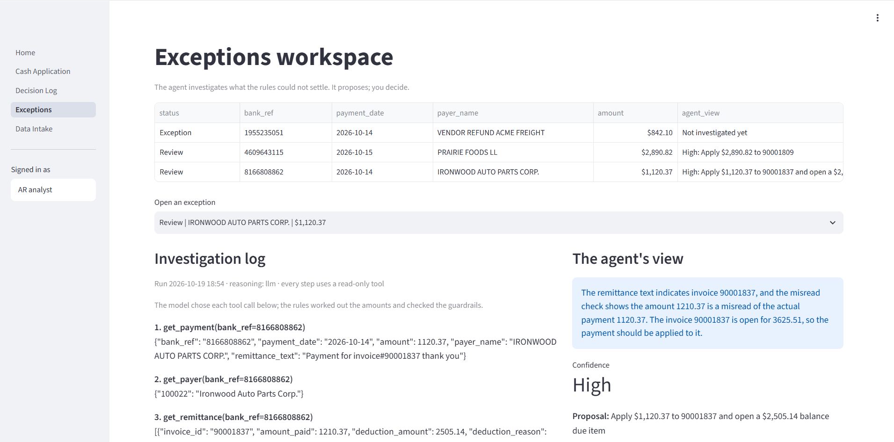
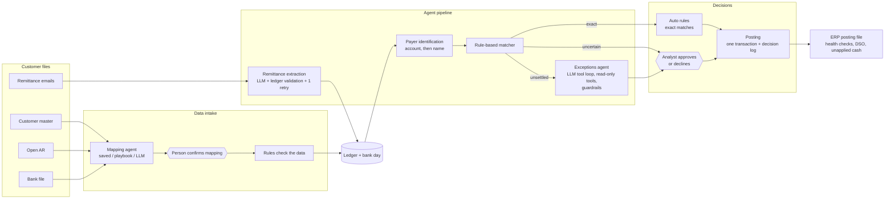

# AI Cash Application Agent (order to cash)

A working prototype of an agentic cash application product for accounts receivable.
It takes a company's own files (customer master, open AR, bank statement, remittance emails),
in whatever layout its ERP and bank produce, and applies incoming cash to invoices.
AI reads, maps and investigates; deterministic rules match and check; a person approves anything uncertain.

> All data in this repository is synthetic. Results are measured against a built-in answer key.



## What it does

1. **Data intake.** Upload customer master, open AR or a bank file as CSV or Excel. A mapping agent proposes
   which column feeds which field (it reads SAP exports such as `KUNNR`, `BELNR`, `WRBTR`), a person confirms,
   rules check the data, and only then does it load, with a backup first. Confirmed layouts are remembered.
2. **Remittance extraction.** A language model reads each remittance email into structured lines
   (invoice, amount paid, deduction, reason). Every answer is validated against the ledger; a failed answer
   gets one retry with the validation result as feedback, and otherwise goes to a person.
3. **Payer identification.** By bank account fingerprint first, then by name. Raw account numbers are never stored.
4. **Matching.** A rule-based matcher proposes how to apply each payment, including short pays as residual items.
5. **Exceptions agent.** For payments the rules could not settle, an agent investigates with read-only tools
   (a language model chooses the steps) and proposes one action with its evidence. Guardrails check every proposal.
6. **Approval and posting.** Exact matches post under agreed Auto rules; everything else needs a person.
   Posting runs in one transaction, writes a decision log, and produces the file an ERP would load.
7. **Daily health checks.** Cash posted equals the drop in open AR to the cent, no negative balances,
   every posting has an approval, every short pay has its residual item, no duplicate IDs.

## Architecture



**Where AI is used, and where it is not**

| Step | Who decides | Why |
|---|---|---|
| Column mapping | LLM proposes, person confirms | Layouts vary endlessly; a wrong mapping corrupts everything downstream |
| Reading remittances | LLM extracts, rules validate against the ledger | Free text is what models are good at; numbers must reconcile |
| Matching | Rules | Must be explainable and repeatable |
| Investigating exceptions | LLM chooses read-only tools, rules compute amounts and check guardrails | Judgment on evidence; arithmetic stays in code |
| Posting | Person, or an agreed Auto rule | Money moves only with an accountable approver |

## Results (synthetic test data)

| Measure | Result |
|---|---|
| Remittance lines read correctly by the LLM (gpt-oss:20b) | 17 of 17 in two runs; 15 of 17 in a third, both misses caught by validation |
| Payments applied automatically | 93–98% across runs |
| Accuracy of automatic matches | 100% |
| Payments put on the wrong customer | 0 |
| Gap between cash posted and the drop in AR | $0.00 |
| Bank layouts loaded through the same mapping engine | 2 (credit/debit columns; one signed amount column) |

**Exceptions agent: model comparison on two hard cases**

| Model | Wrong invoice number on the remittance | Two digits swapped in the amount |
|---|---|---|
| Rule playbook | Correct | Correct |
| qwen2.5:3b (local) | Proposed another customer's invoice; **blocked by guardrails** | Correct invoice, weak explanation |
| qwen3:4b (local) | Too slow on a 2-core CPU | Too slow |
| gpt-oss:20b (Ollama Cloud) | Correct, explained the misread | Correct, used the `check_misread` tool on the right pair |

In every run the model only proposed; guardrails and a person decided.

## Run it

Open the repository in GitHub Codespaces (or any machine with Python 3.11+), then from the repo root:

```bash
pip install -r requirements.txt
export BANK_HASH_KEY="any-random-text"     # better: add it as a Codespaces secret

# build the synthetic data
python generators/generate_ledger.py
python generators/make_bank_file.py
python pipeline/load_bank_file.py
python generators/make_remittances.py
python pipeline/extract_remittances.py
python generators/make_bank_accounts.py
python pipeline/load_bank_accounts.py
python pipeline/identify_payer.py
python pipeline/matcher.py
python tools/grade_matcher.py
python generators/make_sample_uploads.py   # sample files for the Data Intake page

streamlit run Home.py
```

**Language models.** Without a model the app still runs: remittance extraction uses prepared answers
(`EXTRACTOR = "stub"` in `pipeline/extract_remittances.py`, with two deliberate misreads for the
exceptions agent to catch) and the exceptions agent can use its rule playbook. To use real models:

- **Local:** install [Ollama](https://ollama.com), run `ollama serve`, then `ollama pull qwen2.5:3b`.
- **Cloud:** create a key at ollama.com and add it as the `OLLAMA_API_KEY` Codespaces secret;
  the code then uses `gpt-oss:20b`. Keys are read from the environment only, never written in code.

## Repository layout

| Folder | What is in it |
|---|---|
| `Home.py`, `pages/` | Streamlit app: dashboard, cash application, decision log, exceptions, data intake |
| `o2c/` | The engine: posting, health checks, exceptions agent, LLM planner, data intake |
| `pipeline/` | Product steps run as scripts: load bank file, extract remittances, identify payer, matcher |
| `generators/` | Synthetic test data, not part of the product |
| `samples/` | Upload files in other layouts: SAP customer master and open items, a second bank |
| `sql/` | Reporting queries: aging, DSO, worklist |
| `docs/` | Matching rules, the operating-model deck, screenshots |

## The bigger picture

The prototype is the first step of a wider design for agentic finance across order to cash,
procure to pay, record to report, treasury and FP&A:
[Agentic Finance Operating Model (PDF)](docs/agentic-finance-operating-model.pdf).

## Limitations and next steps

- Synthetic data only; one entity, one currency.
- Bank standard formats (BAI2, camt.053) and PDF remittances are not yet supported.
- Model outputs vary from run to run; results above are reported as ranges for that reason.
- Next: deductions and collections agents, a second ERP's chart of accounts through the mapping agent.

---
Built by Shubham Khadria · [LinkedIn](https://www.linkedin.com/in/REPLACE-ME)